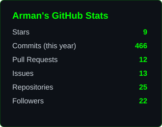
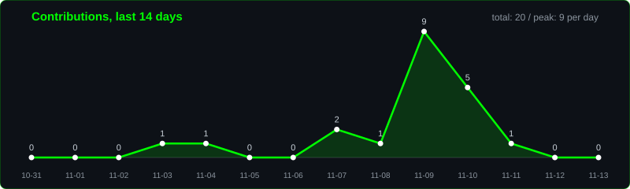
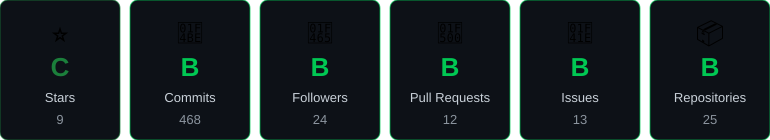

<div align="center">


<a href="https://github.com/Arman-Sadeghi-2003">
  
</a>

**Building cross-platform apps with C#, .NET MAUI, Avalonia, and AI agent frameworks like AutoGen and Pydantic**


</div>

---

## 🧑‍💻 About Me

I'm a **.NET Developer** based in **Tehran, Iran**, specializing in **cross-platform applications** with **C#**, **.NET MAUI**, and **Avalonia**. I'm currently focused on **AI agent frameworks**: **Pydantic**, **AutoGen (.NET/Python)**, and **Azure AI Foundry**.

```csharp
var arman = new Developer
{
    Location     = "Tehran, Iran",
    Role         = ".NET Developer & Cross-Platform Architect",
    Passions     = ["Cross-Platform Development", "AI Integration", "UI/UX Design"],
    CurrentFocus = "Pydantic, AutoGen .NET/Python & Azure AI Foundry",
    TechStack    = ["C#", ".NET", "Python", "Pydantic", "AutoGen", "Azure AI"],
    Motto        = "Code once, run everywhere! 🚀"
};
```

| | Focus | Description |
|---|---|---|
| 🚀 | **.NET Innovation** | Pushing the .NET ecosystem further |
| 🌐 | **Cross-Platform** | C#/.NET MAUI and Avalonia on desktop, mobile, and web |
| 🤖 | **AI Integration** | Agent-based features with AutoGen and Azure AI |
| 🔧 | **Problem Solving** | Complex problems into maintainable solutions |

---

## 🛠️ Tech Stack

<div align="center">

**Languages**<br/>


**Frameworks and AI**<br/>


**Databases**<br/>


**Design**<br/>


**Tools**<br/>


</div>

---

## 🤝 Let's Collaborate

```diff
+ AI Agent Frameworks (AutoGen .NET/Python)
+ Data Validation and Modeling (Pydantic)
+ Azure AI Foundry and Cloud AI Solutions
+ Cross-Platform Applications (Avalonia, MAUI)
+ Open Source AI Projects and Community Building
```

> **Philosophy:** "Validate data, automate agents, scale intelligence" 🌟

---

## 📊 GitHub Analytics

<div align="center">



<br/><br/>


<br/><br/>



</div>

---

## 🏆 Achievements

<div align="center">



</div>

---

## 📫 Connect With Me

<div align="center">

<a href="https://x.com/_Arman_Sadeghi"></a>
<a href="https://github.com/Arman-Sadeghi-2003"></a>
<a href="https://t.me/AILC_AS"></a>
<br/>
<a href="mailto:ailc.company.arman@gmail.com"></a>
<a href="mailto:armanwollf007@gmail.com"></a>
<a href="mailto:Terminator_arman@yahoo.com"></a>

**💬 Let's talk .NET, cross-platform architecture, AI agents, and Azure AI!**

<em>I love connecting with fellow developers. Say hi, I'll be happy to meet you! 🙂</em>


</div>
